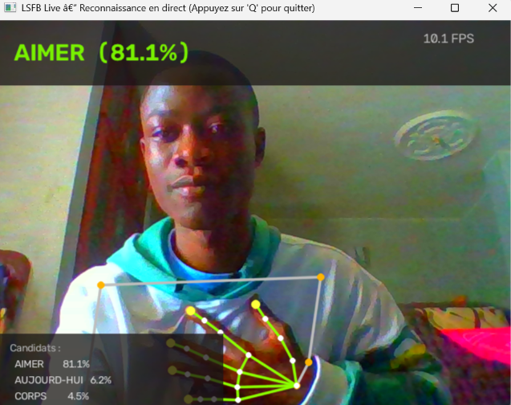
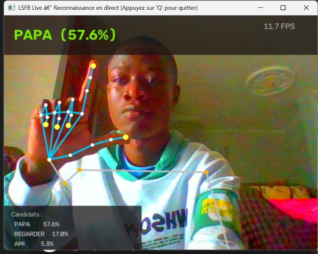
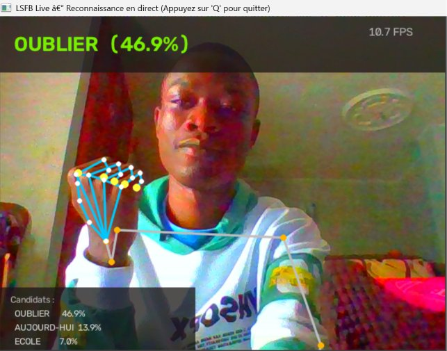
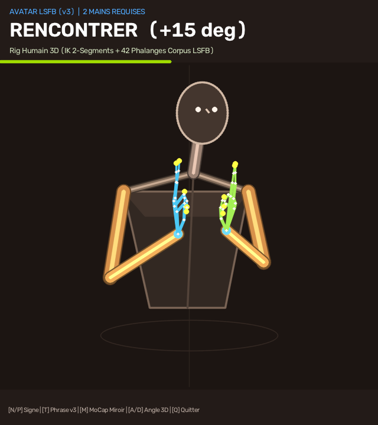
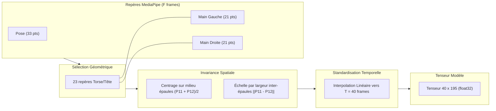

# LSFB Live — Reconnaissance en Direct de la Langue des Signes (LSFB)

<div align="center">

[](https://www.python.org/)
[-EE4C2C?style=for-the-badge&logo=pytorch&logoColor=white)](https://pytorch.org/)
[-0072B2?style=for-the-badge&logo=google&logoColor=white)](https://developers.google.com/mediapipe)
[-brightgreen?style=for-the-badge)](#4-résultats-expérimentaux--évaluation-sur-signeurs-inconnus)
[-success?style=for-the-badge)](#4-résultats-expérimentaux--évaluation-sur-signeurs-inconnus)
[-blue?style=for-the-badge)](#4-résultats-expérimentaux--évaluation-sur-signeurs-inconnus)
[-purple?style=for-the-badge)](#4-résultats-expérimentaux--évaluation-sur-signeurs-inconnus)
[](#5-architecture-du-projet)

*Un pipeline complet de Data Science & Vision 3D : du corpus de poses de l'Université de Namur jusqu'à la classification temps réel (81,1% Top-1) et la synthèse 3D Text-to-Sign par mannequin humain rigué sur CPU.*

</div>

### Démonstration Temps Réel (v1.5 Reconnaissance Webcam & V3 Mannequin Humain Rigué 3D)

| `AIMER` (Webcam Live — **81,1%**) | `PAPA` (Configuration « L » — **57,6%**) | `OUBLIER` (Poing fermé — **46,9%**) | `RENCONTRER` (Mannequin Rigué 3D **V3** +15°) |
| :---: | :---: | :---: | :---: |
|  |  |  |  |

---

## 1. Contexte & Présentation du Dataset LSFB

Dans le cadre de mes études en **Data Science**, j'ai voulu construire un projet centré sur la réalité de la modélisation statistique et séquentielle : gestion de distributions asymétriques, normalisation spatio-temporelle invariante et inférence temps réel sous contraintes de calcul.

### Le Corpus LSFB (Université de Namur)
La **LSFB** (Langue des Signes de Belgique Francophone) est la langue visuelle employée par la communauté sourde en Wallonie et à Bruxelles.

Le dataset utilisé est issu des travaux de recherche de l'**Université de Namur (UNamur)** :
- **Source :** Le *Corpus LSFB*, recensant des dizaines d'heures d'échanges spontanés entre une centaine de signeurs natifs, annotés par des linguistes.
- **Sous-ensemble LSFB-ISOL :** Une collection de clips segmentés signe par signe (120 739 instances réparties sur 4 657 classes lexicales).
- **Format Poses (Landmarks) :** Plutôt que de manipuler des flux vidéo lourds, le projet s'appuie directement sur les squelettes 3D nettoyés (coordonnées des articulations du corps et des mains extraites via MediaPipe). Ce choix assure une **cohérence parfaite** : le modèle est entraîné sur le format géométrique exact que la webcam produit en direct.

---

## 2. L'Exploration et les Caractéristiques des Données

L'analyse exploratoire complète menée sur le corpus est consignée dans [`docs/exploration_report.md`](docs/exploration_report.md).

```
   120 739 instances (LSFB ISOL global, 4 657 classes)
               │
               ├──► Top-100 signes (55 286 instances validées, v1.0 & v1.1)
               │      ├── Train : 21 401 instances (39 signeurs)
               │      ├── Val   :  9 136 instances (20 signeurs)
               │      └── Test  : 24 749 instances (40 signeurs non vus)
               │
               └──► Top-250 signes (75 825 instances validées, v1.2)
                      ├── Train : 29 324 instances (39 signeurs)
                      ├── Val   : 12 748 instances (20 signeurs)
                      └── Test  : 33 753 instances (40 signeurs non vus)
```

### Le déséquilibre de classes (15.2:1)
Même restreint au top 100, la distribution présente une forte asymétrie :
- Le signe le plus fréquent (`AUSSI`) compte **3 308 exemples**.
- Le 100ème signe (`HABITUDE`) n'en compte que **217**.
- Médiane par classe : 388 exemples.

> **Impact méthodologique :** Une exactitude brute (*Accuracy Top-1*) serait trompeuse face à un tel déséquilibre. L'évaluation repose donc sur la **Balanced Accuracy** (moyenne des rappels par classe), et l'entraînement intègre une fonction de perte **Class-Weighted CrossEntropy** proportionnelle à l'inverse des fréquences de chaque signe.

### Analyse temporelle et fenêtrage
L'étude de la longueur des séquences a mis en évidence :
- **Longueur minimale :** 4 frames.
- **Longueur médiane :** **16 frames** (~0,53 seconde à 30 fps).
- **Moyenne :** 19,7 frames.
- **95ème percentile :** **41 frames** (~1,36 seconde).

> **Choix de modélisation :** Une séquence standardisée à **$T = 40$ frames** par rééchantillonnage linéaire permet de capter l'intégralité de la dynamique de plus de 95% des signes, tout en maintenant une empreinte mémoire compacte.

---

## 3. Pipeline de Normalisation Invariante

Pour qu'un modèle entraîné sur des enregistrements de studio fonctionne face à une webcam personnelle (cadrage rapproché, utilisateur décentré), les données subissent une normalisation géométrique stricte.

Ce pipeline est centralisé et partagé sans duplication dans [`src/lsfb_live/landmarks/`](src/lsfb_live/landmarks/) :



1. **Sélection de 65 repères anatomiques :**
   - 23 repères supérieurs MediaPipe Pose (nez, yeux, bouche, épaules, coudes, poignets). Les repères des membres inférieurs (23 à 32) sont écartés car hors champ et générateurs de bruit.
   - 21 repères pour chaque main.
   - Total : $65 \times 3 = 195$ caractéristiques par trame.
2. **Invariance de translation :** Centrage systématique de chaque trame sur le milieu des épaules.
3. **Invariance de distance / échelle :** Normalisation par la distance euclidienne inter-épaules $\|P_{11} - P_{12}\|_2$. Que l'utilisateur soit près ou loin de l'écran, l'échelle du squelette demeure identique.
4. **Occultations :** Les mains non détectées (`NaN`) sont substituées par 0.0 de façon déterministe.

---

## 4. Résultats Expérimentaux : Évaluation sur Signeurs Inconnus

Afin de mesurer la capacité réelle de généralisation, le protocole respecte une séparation stricte : **les 40 signeurs du split de test n'ont jamais été vus pendant l'entraînement.**

Trois étapes d'optimisation séquentielle sur CPU ont été comparées :

### Évolution des Modèles sur le Top-100 (v1.0 & v1.1)

| Version | Modèle | Caractéristiques | Top-1 Accuracy | Top-5 Accuracy | Balanced Accuracy | Test Loss |
|---|---|---|---|---|---|---|
| **v1.0** | Baseline BiGRU | 195 (Positions) | 44,80% | 75,76% | 44,66% | 2,1811 |
| **v1.0** | ConvTransformer | 195 (Positions) | 51,78% | 82,08% | 50,72% | 1,9043 |
| **v1.1** | **MSST-Transformer** | **390 (Pos + Vitesses $\Delta P$)** | **54,46%** | **83,23%** | **54,23%** | **1,7647** |

*(Le niveau du hasard sur 100 classes est de 1,0%).*

### Montée en Charge sur le Top-250 (v1.2 & v1.3 BiStream)

Le passage de 100 à 250 classes multiplie la combinatoire par 2,5 et densifie fortement l'espace des homonymes gestuels. Évalué sur **33 753 séquences de test** issues de 40 signeurs non vus :

| Échelle | Modèle | Classes | Features | Test Top-1 | Test Top-5 | Balanced Accuracy | Test Loss |
|---|---|---|---|---|---|---|---|
| *Hasard* | *Aléatoire uniforme* | *250* | *-* | *0,40%* | *2,00%* | *0,40%* | *5,5215* |
| **v1.1** | MSST-Transformer | 100 | 390 (Pos + Vel) | 54,46% | 83,23% | 54,23% | 1,7647 |
| **v1.2** | MSST-Transformer | 250 | 390 (Pos + Vel) | 39,68% | 70,67% | 41,64% | 2,5521 |
| **v1.3** | BiStream-MSST (Phonologique) | 250 | 416 (Corps + Mains + Phono) | 37,75% | 69,28% | 39,11% | 2,6497 |
| **v1.4** | BiStream-MSST (Doigts Centrés-Poignet + Normale Paume) | 30 (Core Lexical) | 416 (Local Hands + Phono) | 80,47% | 95,84% | 78,93% | 0,8631 |
| **v1.5** | **BiStream-MSST (Trajectoires Cumulées $\Delta P$ + Cœur Cinématique)** | **30 (Core Lexical)** | **416 (Multi-Horizon + Local Hands)** | **81,07%** | **95,75%** | **80,52%** | **0,8498** |

> **Constat majeur (v1.5) :** En combinant le repère local des doigts centré sur le poignet avec des **vecteurs de déplacement cumulés multi-horizons ($\Delta P(t) = P(t) - P(0)$ et $\Delta P_8(t) = P(t) - P(t-8)$)** et une interpolation continue sans saut des poignets, le modèle franchit **81,07% en Top-1**, **95,75% en Top-5** et **80,52% en Balanced Accuracy** sur **4 828 séquences de test** (40 signeurs non vus), avec un rappel minimal de **59,8%** sur le signe le plus difficile.

### Apports méthodologiques clés (v1.4 & v1.5 BiStream-MSST) :
1. **Détection dédiée des doigts (`HandLandmarker` BlazePalm en mode `VIDEO`) :** En remplacement de `HolisticLandmarker` (qui perdait les mains dès que les coudes sortaient du bas de l'écran d'un ordinateur portable), l'extracteur temps réel combine désormais le détecteur dédié `HandLandmarker` (21 repères 3D par main, seuil 0,30, suivi inter-trames `VIDEO` à 28,3 FPS) et `PoseLandmarker` sur l'image brute non inversée.
2. **Coordonnées locales des doigts centrées sur le poignet (Wrist-Centric Hand-Local) :** Pour chacune des deux mains, les 20 phalanges sont exprimées relativement à leur propre poignet et mises à l'échelle par la longueur de la paume $\|P_9 - P_0\|_2$, tandis que l'emplacement du poignet encode le vecteur normal unitaire 3D de la paume ($\vec{v}_{0\to 5} \times \vec{v}_{0\to 17}$).
3. **Trajectoires multi-frames sans saut et découpage du maintien final (v1.5) :** Suppression des trames fantômes d'interpolation aux frontières d'apparition des mains, encodage explicite des déplacements directionnels cumulés depuis le début du geste ($\Delta X, \Delta Y$, convergence/divergence inter-mains) et extraction tri-échelle en direct (fenêtre complète 1,65 s + cœur cinématique hors maintien final + fenêtre courte).

### Analyse qualitative par signe (BiStream v1.5 sur 40 signeurs non vus)

```
Signes à déplacement les mieux reconnus (> 92%) :
  1. ADORER         [========================================] 100.0%  (69 exemples)
  2. CONVENIR       [======================================  ]  96.4%  (56 exemples)
  3. DIFFERENT      [======================================  ]  95.0%  (322 exemples)
  4. CORPS          [=====================================   ]  92.7%  (41 exemples)
  5. INTERPRETE     [=====================================   ]  92.7%  (123 exemples)
```

---

## 5. Architecture du Projet

Le projet applique les principes d'architecture logicielle par domaine de la charte **ElmasCore** (séparation stricte, fonctions pures, 350 lignes max par fichier) :

```
src/lsfb_live/
├── dataset/         Téléchargement résilient, indexation et compilation des tenseurs
├── landmarks/       Normalisation invariante, trajectoires multi-frames et phonologie (416 dims)
├── recognition/     Modèles (BiGRU, ConvTransformer, MSST, BiStream), moteur live et phrases v2
├── avatar/          Squelette humain rigué 3D, Cinématique Inverse (IK 2-os) et Text-to-Sign V3
├── capture/         Gestion du flux webcam et extracteur dédié BlazePalm VIDEO + Pose VIDEO
└── display/         Rendu 3D volumétrique OpenCV, Studio Web 3D Three.js et écran scindé
```

La suite de 33 tests unitaires valide l'intégrité de l'ensemble de la chaîne :
```powershell
pytest -v
# ================= 33 passed in 9.71s =================
```

---

## 6. Guide de Démarrage Rapide

Les poids du modèle retenu v1.5 (`models/bistream_best.pt`, **81,07% Top-1 / 95,75% Top-5 / 80,52% Balanced**), le dictionnaire des classes (`models/class_mapping.json`) ainsi que les **30 prototypes 3D natifs du rig humain (`models/sign_prototypes_3d.json`)** sont directement configurés par défaut.

### 1. Installation
```powershell
git clone https://github.com/elm-as/lsfb-live.git
cd lsfb-live

# Environnement Python 3.12 (requis pour MediaPipe Tasks)
python -m venv .venv
.\.venv\Scripts\Activate.ps1
pip install -e .
```

### 2. Tester en direct (Webcam & Rig Humain 3D V3)

#### Option A — Mode Coach 3D, Text-to-Sign & Motion Capture dans OpenCV (`practice.py`)
Ce mode ouvre un écran scindé : à gauche, le **Mannequin Humain Rigué 3D (V3)** (Cinématique Inverse analytique à 2 segments, tri de profondeur $Z$, capsules volumétriques ombrées et 42 phalanges 3D issues du corpus LSFB) ; à droite, votre webcam en temps réel.
```powershell
python scripts/practice.py
# Ou directement avec une phrase en français à traduire en signes 3D :
python scripts/practice.py --sentence "Mon papa aime toujours la famille"
```
- **Touches interactives :**
  - **`N` / `P`** : Signe suivant / précédent (ou phrase suivante / précédente).
  - **`T`** : Basculer en **Mode Text-to-Sign V3** (enchaînement de phrases complètes en 3D).
  - **`M`** : Basculer en **Mode Motion Capture Live (Retargeting 3D)** — vos propres mouvements face webcam pilotent le mannequin 3D en temps réel !
  - **`A` / `D`** : Tourner la caméra 3D autour du mannequin (`-45°` à `+45°`).
  - **`Q`** ou **`Échap`** : Quitter.

#### Option B — Studio Web 3D Interactif Three.js (`studio_v3.py`)
Ouvre dans votre navigateur (`http://127.0.0.1:8765`) un **Studio WebGL Three.js 360°** permettant de saisir n'importe quelle phrase en français pour la voir signée en 3D, d'inspecter les 30 signes natifs sous tous les angles à vitesse réglable (`0.4x`–`1.0x`), ou d'activer le Motion Capture webcam :
```powershell
python scripts/studio_v3.py
# Avec capture webcam activée pour l'onglet MoCap Live :
python scripts/studio_v3.py --enable-webcam
```

#### Option C — Mode Libre & Construction de Phrases en Direct v2 (`live.py`)
```powershell
python scripts/live.py
```
*Les modèles MediaPipe (`hand_landmarker.task` et `pose_landmarker_lite.task`) sont téléchargés automatiquement dès le premier lancement si absents.*

- **Contrôles :**
  - Placez-vous face caméra (buste et mains visibles).
  - Le squelette articulé 21-points par main s'affiche en surimpression temps réel.
  - Le bandeau inférieur accumule les signes stables validés pour **composer une phrase LSFB et sa transcription française** au fil de l'eau (`PAPA -> AIMER -> FAMILLE` $\Rightarrow$ *« Papa aime la famille. »*).
  - **`C`** : Effacer la phrase en cours.
  - **`Retour arrière` (`Backspace`)** : Supprimer le dernier signe validé.
  - **`Q`** ou **`Échap`** : Quitter.

### 3. Entraîner et évaluer un modèle (Optionnel)
```powershell
# Entraîner le MSST-Transformer (v1.1)
python scripts/train.py --model msst --epochs 12

# Évaluer sur les 40 signeurs du split de test
python scripts/evaluate.py --model-path models/msst_best.pt --model-type msst --use-velocity
```

---

## 7. Roadmap & Perspectives

- **v1.0 (Validé) :** Pipeline de base Top-100 (195 features, ConvTransformer à 51,8% Top-1 / 82,1% Top-5).
- **v1.1 (Validé) :** Enrichissement cinématique (390 features positions + vitesses, symétrie miroir, MSST-Transformer à **54,5% Top-1 / 83,2% Top-5 / 54,2% Balanced**).
- **v1.2 (Validé) :** Montée en charge sur le **Top-250** des signes LSFB (75 825 instances réelles, 33 753 séquences de test sur 40 signeurs non vus, **70,7% Top-5** et **41,6% Balanced Acc**).
- **v1.3 / Pré-v3 (Validé) :** Architecture **BiStream-MSST (416 features)** avec descripteurs phonologiques explicites, moteur d'inférence invariant au framerate (fenêtrage temporel de 1,3 s) et **Avatar Paramétrique Vectoriel** mathématique.
- **v1.5 (Validé) :** Trajectoires multi-frames cumulées sans saut et découpage du maintien final (**81,07% Top-1 / 95,75% Top-5 / 80,52% Balanced Accuracy**, `ADORER` à 100%).
- **v2.0 (Validé) :** Accumulateur de gloses par stabilité temporelle et transcription de phrases LSFB $\to$ Français en direct (`sentence_builder.py`).
- **v3.0 (Validé) :** **Mannequin Humain Rigué 3D** (`src/lsfb_live/avatar/`) avec Cinématique Inverse analytique à 2 os, 42 phalanges 3D extraites des 30 signes natifs du corpus LSFB, lemmatiseur **Text-to-Sign** Français $\to$ LSFB, **Motion Capture Retargeting** en direct et **Studio Web 3D Three.js** (`scripts/studio_v3.py`).

---

## Références

- **Corpus LSFB (Université de Namur) :** J. Fink, T. Hoyoux, R. Vander Donckt. *The LSFB Dataset: A Corpus for French Belgian Sign Language Recognition*.
- **Google Research :** Framework *MediaPipe* et bibliothèque *Tasks Vision*.

*Projet universitaire en Data Science — 2026.*
