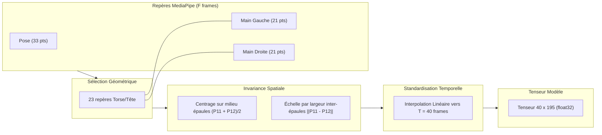

# LSFB Live — Reconnaissance en Direct de la Langue des Signes (LSFB)

<div align="center">

[](https://www.python.org/)
[-EE4C2C?style=for-the-badge&logo=pytorch&logoColor=white)](https://pytorch.org/)
[](https://developers.google.com/mediapipe)
[](#4-résultats-expérimentaux--évaluation-sur-signeurs-inconnus)
[](#4-résultats-expérimentaux--évaluation-sur-signeurs-inconnus)
[](#4-résultats-expérimentaux--évaluation-sur-signeurs-inconnus)

*Un pipeline complet de Data Science : du corpus de poses de l'Université de Namur jusqu'à la classification temps réel face webcam sur un processeur standard d'ordinateur portable, sans carte graphique dédiée.*

</div>

---

## 1. Contexte & Présentation du Dataset LSFB

Dans le cadre de mes études en **Data Science**, j'ai voulu construire un projet centré sur la réalité de la modélisation statistique et séquentielle : gestion de distributions asymétriques, normalisation spatio-temporelle invariante et inférence temps réel sous contraintes de calcul.

### Le Corpus LSFB (Université de Namur)
La **LSFB** (Langue des Signes de Belgique Francophone) est la langue visuelle employée par la communauté sourde en Wallonie et à Bruxelles.

Le dataset utilisé est issu des travaux de recherche de l'**Université de Namur (UNamur)** :
- **Source :** Le *Corpus LSFB*, recensant des dizaines d'heures d'échanges spontanés entre une centaine de signeurs natifs, annotés par des linguistes.
- **Sous-ensemble LSFB-ISOL :** Une collection de clips segmentés signe par signe (120 739 instances réparties sur 4 657 classes lexicales).
- **Format Poses (Landmarks) :** Plutôt que de manipuler des flux vidéo lourds, le projet s'appuie directement sur les squelettes 3D nettoyés (coordonnées des articulations du corps et des mains extraites via MediaPipe). Ce choix assure une **cohérence parfaite** : le modèle est entraîné sur le format géométrique exact que la webcam produit en direct.

---

## 2. L'Exploration et les Caractéristiques des Données

L'analyse exploratoire complète menée sur le corpus est consignée dans [`docs/exploration_report.md`](docs/exploration_report.md).

```
   120 739 instances (LSFB ISOL global)
               │
               ▼  Sélection du Top-100 signes les plus fréquents (46,0% du corpus)
    55 599 instances ciblées
               │
               ▼  Élimination des 313 séquences vides (0 frame)
    55 286 instances exploitables
       ├── Train (Folds 2 & 3) : 21 401 instances (39 signeurs)
       ├── Val   (Fold 4)       :  9 136 instances (20 signeurs)
       └── Test  (Folds 0 & 1)  : 24 749 instances (40 signeurs non vus)
```

### Le déséquilibre de classes (15.2:1)
Même restreint au top 100, la distribution présente une forte asymétrie :
- Le signe le plus fréquent (`AUSSI`) compte **3 308 exemples**.
- Le 100ème signe (`HABITUDE`) n'en compte que **217**.
- Médiane par classe : 388 exemples.

> **Impact méthodologique :** Une exactitude brute (*Accuracy Top-1*) serait trompeuse face à un tel déséquilibre. L'évaluation repose donc sur la **Balanced Accuracy** (moyenne des rappels par classe), et l'entraînement intègre une fonction de perte **Class-Weighted CrossEntropy** proportionnelle à l'inverse des fréquences de chaque signe.

### Analyse temporelle et fenêtrage
L'étude de la longueur des séquences a mis en évidence :
- **Longueur minimale :** 4 frames.
- **Longueur médiane :** **16 frames** (~0,53 seconde à 30 fps).
- **Moyenne :** 19,7 frames.
- **95ème percentile :** **41 frames** (~1,36 seconde).

> **Choix de modélisation :** Une séquence standardisée à **$T = 40$ frames** par rééchantillonnage linéaire permet de capter l'intégralité de la dynamique de plus de 95% des signes, tout en maintenant une empreinte mémoire compacte.

---

## 3. Pipeline de Normalisation Invariante

Pour qu'un modèle entraîné sur des enregistrements de studio fonctionne face à une webcam personnelle (cadrage rapproché, utilisateur décentré), les données subissent une normalisation géométrique stricte.

Ce pipeline est centralisé et partagé sans duplication dans [`src/lsfb_live/landmarks/`](src/lsfb_live/landmarks/) :



1. **Sélection de 65 repères anatomiques :**
   - 23 repères supérieurs MediaPipe Pose (nez, yeux, bouche, épaules, coudes, poignets). Les repères des membres inférieurs (23 à 32) sont écartés car hors champ et générateurs de bruit.
   - 21 repères pour chaque main.
   - Total : $65 \times 3 = 195$ caractéristiques par trame.
2. **Invariance de translation :** Centrage systématique de chaque trame sur le milieu des épaules.
3. **Invariance de distance / échelle :** Normalisation par la distance euclidienne inter-épaules $\|P_{11} - P_{12}\|_2$. Que l'utilisateur soit près ou loin de l'écran, l'échelle du squelette demeure identique.
4. **Occultations :** Les mains non détectées (`NaN`) sont substituées par 0.0 de façon déterministe.

---

## 4. Résultats Expérimentaux : Évaluation sur Signeurs Inconnus

Afin de mesurer la capacité réelle de généralisation, le protocole respecte une séparation stricte : **les 40 signeurs du split de test n'ont jamais été vus pendant l'entraînement.**

Deux architectures séquentielles adaptées à l'inférence temps réel sur CPU ont été comparées :

| Métrique | Baseline BiGRU | **ConvTransformer (Retenu)** | Écart |
|---|---|---|---|
| **Test Top-1 Accuracy** | 44,80% | **51,78%** | **+6,98%** |
| **Test Top-5 Accuracy** | 75,76% | **82,08%** | **+6,32%** |
| **Balanced Accuracy** | 44,66% | **50,72%** | **+6,06%** |
| **Test CrossEntropy Loss** | 2,1811 | **1,9043** | **-0,28** |
| **Nombre de paramètres** | 320 000 | 480 000 | — |
| **Inférence CPU par fenêtre** | ~1,2 ms | ~1,8 ms | Temps réel fluide |

*(Le niveau du hasard sur 100 classes est de 1,0%).*

> **Bilan :** Face à des signeurs inconnus, le ConvTransformer classe le signe exact en tête dans **plus d'un cas sur deux (51,8%)**, et le bon signe figure dans les 5 premiers candidats suggérés dans **82,1% des cas**.

### Analyse qualitative par signe

```
Signes les mieux reconnus (> 85%) :
  1. COMMUNICATION  [========================================] 92.1%  (89 exemples)
  2. INTERPRETE     [======================================= ] 90.2%  (123 exemples)
  3. RENCONTRER     [======================================  ] 88.9%  (117 exemples)
  4. C-EST          [=====================================   ] 86.2%  (398 exemples)
  5. DIFFERENT      [===================================     ] 80.4%  (322 exemples)

Signes les plus ambigus (< 20%) :
  1. APPELER        [======                                  ] 13.9%  (223 exemples)
  2. DIRE           [======                                  ] 14.8%  (512 exemples)
  3. PETIT          [=======                                 ] 16.5%  (133 exemples)
  4. ALLER          [=======                                 ] 17.0%  (182 exemples)
  5. FINIR          [========                                ] 18.0%  (283 exemples)
```

- **Forces :** Les signes bimanités avec une grande amplitude spatiale (`COMMUNICATION`, `INTERPRETE`, `RENCONTRER`) atteignent des taux de reconnaissance très élevés.
- **Difficultés :** Les signes très courts à une seule main (`DIRE`, `APPELER`, `PETIT`), basés sur des variations fines des doigts proches du visage, restent plus délicats à séparer sans contexte phrastique.

---

## 5. Architecture du Projet

Le projet applique les principes d'architecture logicielle par domaine de la charte **ElmasCore** (séparation stricte, fonctions pures, 350 lignes max par fichier) :

```
src/lsfb_live/
├── dataset/         Téléchargement résilient, indexation et compilation des tenseurs
├── landmarks/       Constantes MediaPipe et pipeline de normalisation invariante
├── recognition/     Modèles (BiGRU & Transformer), entraînement pondéré, moteur live
├── capture/         Gestion du flux webcam et extracteur MediaPipe Tasks Holistic
└── display/         Rendu OpenCV du squelette articulé et bandeau de prédiction
```

La suite de 16 tests unitaires valide l'intégrité de la chaîne :
```powershell
pytest -v
# ================= 16 passed in 6.59s =================
```

---

## 6. Guide de Démarrage Rapide

Les poids du modèle ConvTransformer (`models/transformer_best.pt`) ainsi que le dictionnaire des 100 classes sont directement inclus dans le dépôt.

### 1. Installation
```powershell
git clone https://github.com/elm-as/lsfb-live.git
cd lsfb-live

# Environnement Python 3.12 (requis pour MediaPipe Tasks)
python -m venv .venv
.\.venv\Scripts\Activate.ps1
pip install -e .
```

### 2. Lancer la reconnaissance en direct (Webcam)
```powershell
python scripts/live.py
```
*Le modèle MediaPipe Holistic (`holistic_landmarker.task`, 13 Mo) est téléchargé automatiquement dès le premier lancement si absent.*

- **Contrôles :**
  - Placez-vous face caméra (buste et mains visibles).
  - Le squelette articulé s'affiche en surimpression temps réel.
  - Le signe détecté et le niveau de confiance s'affichent en haut à gauche.
  - Le top-3 des candidats alternatifs est affiché en bas à gauche.
  - Appuyez sur **`Q`** ou **`Échap`** pour quitter.

### 3. Reproduire le pipeline complet (Optionnel)
```powershell
# 1. Télécharger les poses brutes du top-100 (500 Mo, ~166 000 fichiers)
python scripts/download_lsfb_isol.py --top-k 100

# 2. Prétraiter et compiler les tenseurs normalisés
python scripts/preprocess.py --top-k 100

# 3. Entraîner le ConvTransformer sur CPU
python scripts/train.py --model transformer --epochs 12

# 4. Évaluer sur les 40 signeurs du split de test
python scripts/evaluate.py --model-path models/transformer_best.pt --model-type transformer
```

---

## 7. Perspectives

- **V2 — Reconnaissance continue :** Extension vers le corpus LSFB-CONT avec segmentation temporelle continue (modèles CTC / Transducer) et alignement sur la syntaxe française via un modèle de langage.
- **V3 — Text-to-Sign :** Génération inverse de trajectoires de poses 3D à partir de texte brut pour animer un avatar virtuel.

---

## Références

- **Corpus LSFB (Université de Namur) :** J. Fink, T. Hoyoux, R. Vander Donckt. *The LSFB Dataset: A Corpus for French Belgian Sign Language Recognition*.
- **Google Research :** Framework *MediaPipe* et bibliothèque *Tasks Vision*.

*Projet universitaire en Data Science — 2026.*
