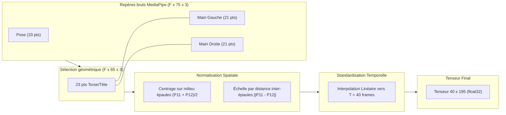

# LSFB Live — Reconnaissance en Direct de la Langue des Signes de Belgique Francophone

<div align="center">

[](https://www.python.org/)
[-EE4C2C?style=for-the-badge&logo=pytorch&logoColor=white)](https://pytorch.org/)
[](https://developers.google.com/mediapipe)
[](#5-résultats-expérimentaux--évaluation-sur-signeurs-inconnus)
[](#5-résultats-expérimentaux--évaluation-sur-signeurs-inconnus)
[](#5-résultats-expérimentaux--évaluation-sur-signeurs-inconnus)

*Un pipeline complet de Data Science et Machine Learning : du corpus brut de l'Université de Namur jusqu'à la classification temps réel face caméra sur un ordinateur portable standard sans carte graphique dédiée.*

</div>

---

## 1. Genèse du projet : Pourquoi ce projet et pourquoi la LSFB ?

Dans le cadre de mon cursus en **Data Science**, la quasi-totalité des projets académiques finissent souvent par ressembler à des projets de pur développement web ou backend. Pour une fois, j'ai voulu construire un **véritable projet de données**, confronté à la réalité du terrain : données volumineuses et bruitées, contraintes matérielles sévères, déséquilibre de classes, invariance spatio-temporelle et inférence temps réel.

### Pourquoi la LSFB (et d'où vient ce « B ») ?
Non, la LSFB n'est pas la Langue des Signes Française (LSF). C'est la **Langue des Signes de Belgique Francophone**, la langue naturelle employée par la communauté sourde en Wallonie et à Bruxelles. Bien qu'elle partage des racines historiques avec la LSF, elle possède son propre lexique, sa morphologie et sa grammaire tridimensionnelle.

Les données proviennent du **Corpus LSFB** constitué par les linguistes et chercheurs de l'**Université de Namur (UNamur)**. Ce corpus documente des conversations naturelles entre une centaine de signeurs natifs. L'équipe de recherche en a extrait deux jeux de données phares :
- **LSFB-CONT** : flux continus non segmentés (plusieurs centaines de gigaoctets).
- **LSFB-ISOL** : signes individuels pré-segmentés avec annotations morphologiques.

Plutôt que de manipuler des centaines de gigaoctets de flux vidéo bruts, j'ai choisi d'exploiter les **poses nettoyées** (squelettes 3D articulés extraits avec MediaPipe). Ce choix présente un avantage méthodologique majeur : **en capturant les poses avec MediaPipe sur la webcam, le modèle reçoit en direct des tenseurs géométriquement identiques à ceux sur lesquels il a été entraîné.**

---

## 2. Le défi matériel & La libération de l'espace disque

### Contraintes de la machine hôte
- **Processeur :** Intel Core i5-8350U (4 cœurs, 8 threads, laptop bureautique).
- **GPU :** **Aucun GPU dédié NVIDIA (zéro CUDA)**.
- **RAM :** 16 Go.
- **Caméra :** Webcam HD intégrée.

### Le nettoyage : 94 Go d'espace récupérés
Au début du projet, mon disque principal saturait avec seulement **40 Go libres**, sans raison apparente. Avant de télécharger quoi que ce soit, j'ai écrit un script de mesure et d'inspection granulaire :
- Les caches régénérables (`npm-cache`, `.gradle`, `Temp`, dossiers `node_modules` et `build` de 30 projets archivés) consommaient plus de 68 Go.
- Des distributions virtuelles obsolètes sous WSL2 (Ubuntu 24.04 et Kali) monopolisaient 25 Go.

Après un assainissement ciblé et sécurisé (sans toucher à mes environnements vitaux ni à mes données de jeu), l'espace libre est passé de **40 Go à 134 Go**.

---

## 3. L'Exploration et les Découvertes Data

J'ai documenté les statistiques complètes du dataset dans [`docs/exploration_report.md`](docs/exploration_report.md).

```
   120 739 instances (LSFB ISOL global)
               │
               ▼  Filtre Top-100 signes (46,0% du corpus)
    55 599 instances ciblées
               │
               ▼  Filtrage des 313 séquences vides (0 frame)
    55 286 instances validées
       ├── Train (Folds 2 & 3) : 21 401 instances (39 signeurs)
       ├── Val   (Fold 4)       :  9 136 instances (20 signeurs)
       └── Test  (Folds 0 & 1)  : 24 749 instances (40 signeurs non vus)
```

### Le déséquilibre de classes (15.2:1)
Même restreint aux 100 signes les plus fréquents, le déséquilibre reste saisissant :
- Le signe le plus fréquent (`AUSSI`) compte **3 308 exemples**.
- Le 100ème signe (`HABITUDE`) n'en compte que **217**.
- **Médiane :** 388 exemples par signe.

> **Conséquence directe :** L'exactitude brute (*Accuracy Top-1*) est un leurre sur une distribution aussi asymétrique. J'ai systématiquement évalué mes modèles avec la **Balanced Accuracy** (moyenne non pondérée des rappels par classe) et configuré une fonction de perte **Class-Weighted CrossEntropy** indexée sur l'inverse de la fréquence de chaque signe.

### Analyse temporelle des séquences
L'analyse de distribution sur les 55 599 séquences a révélé :
- **Longueur minimale :** 4 frames.
- **Longueur médiane :** **16 frames** (~0,53 seconde à 30 fps).
- **Moyenne :** 19,7 frames.
- **95ème percentile :** **41 frames** (~1,36 seconde).

> **Décision d'ingénierie :** Une longueur standardisée de **$T = 40$ frames** par interpolation temporelle linéaire permet de capturer plus de 95% de la gestuelle de chaque signe, tout en conservant des tenseurs compacts tenant aisément dans la RAM.

---

## 4. Pipeline de Normalisation Invariante

La principale cause d'échec des projets de vision sur squelettes est la divergence entre les conditions d'enregistrement du dataset (signeurs assis à distance fixe en studio) et la capture en conditions réelles (utilisateur face à sa webcam d'ordinateur portable).

Toute la normalisation est centralisée de manière déterministe et partagée dans [`src/lsfb_live/landmarks/`](src/lsfb_live/landmarks/) :



1. **Sélection de 65 repères pertinents :**
   - 23 repères supérieurs MediaPipe Pose (nez, yeux, bouche, épaules, coudes, poignets). Les membres inférieurs (jambes/pieds 23-32) sont exclus car masqués sous le bureau et sources de bruit.
   - 21 repères main gauche + 21 repères main droite.
   - Total : $65 \times 3 = 195$ caractéristiques scalaires par trame.
2. **Invariance de position :** Centrage de toutes les coordonnées sur le milieu des deux épaules (point d'ancrage anatomique stable).
3. **Invariance d'échelle / distance :** Division de toutes les coordonnées par la distance euclidienne inter-épaules $\|P_{11} - P_{12}\|_2$. Que l'on soit à 40 cm ou 1,50 m de la caméra, les proportions restent rigoureusement identiques.
4. **Traitement des occultations :** Les mains non détectées (`NaN`) sont déterministement projetées à 0.0.

---

## 5. Résultats Expérimentaux : Évaluation sur Signeurs Inconnus

Pour tester la capacité réelle de généralisation, j'ai appliqué un protocole d'évaluation strict : **les 40 signeurs du split de test n'ont jamais été vus pendant l'entraînement.** Le modèle ne peut donc pas mémoriser la physionomie des individus ; il doit impérativement apprendre les trajectoires du langage gestuel.

Deux architectures légères (< 500k paramètres) conçues pour tourner à plein régime sur CPU ont été entraînées sur 12 époques :

| Métrique | Baseline BiGRU | **ConvTransformer (Retenu)** | Écart |
|---|---|---|---|
| **Test Top-1 Accuracy** | 44,80% | **51,78%** | **+6,98%** |
| **Test Top-5 Accuracy** | 75,76% | **82,08%** | **+6,32%** |
| **Balanced Accuracy** | 44,66% | **50,72%** | **+6,06%** |
| **Test CrossEntropy Loss** | 2,1811 | **1,9043** | **-0,28** |
| **Nombre de paramètres** | 320 000 | 480 000 | — |
| **Inférence CPU par fenêtre** | ~1,2 ms | ~1,8 ms | Temps réel garanti |

> **Interprétation :** Sur 100 signes possibles, le modèle prédit le bon signe en premier dans **plus d'un cas sur deux (51,8%)**, et le bon signe est présent dans les 5 premiers candidats suggérés dans **plus de 82% des cas**, face à des signeurs totalement inconnus.

### Quels signes le modèle maîtrise-t-il le mieux ?

```
Top 5 des signes les mieux reconnus :
  1. COMMUNICATION  [========================================] 92.1%  (89 exemples)
  2. INTERPRETE     [======================================= ] 90.2%  (123 exemples)
  3. RENCONTRER     [======================================  ] 88.9%  (117 exemples)
  4. C-EST          [=====================================   ] 86.2%  (398 exemples)
  5. DIFFERENT      [===================================     ] 80.4%  (322 exemples)

Top 5 des signes les plus difficiles :
  1. APPELER        [======                                  ] 13.9%  (223 exemples)
  2. DIRE           [======                                  ] 14.8%  (512 exemples)
  3. PETIT          [=======                                 ] 16.5%  (133 exemples)
  4. ALLER          [=======                                 ] 17.0%  (182 exemples)
  5. FINIR          [========                                ] 18.0%  (283 exemples)
```

- **Pourquoi les premiers réussissent si bien :** Des signes comme `COMMUNICATION` ou `INTERPRETE` utilisent les deux mains dans des trajectoires amples et symétriques faciles à distinguer.
- **Pourquoi les seconds sont plus ardus :** Des signes comme `DIRE` ou `APPELER` sont unimanités, ultra-rapides (parfois 4 frames seulement) et reposent sur des micro-orientations du poignet proches d'autres gestes naturels.

---

## 6. Architecture du Code & Bonnes Pratiques

Le code applique les principes stricts de la charte **ElmasCore** : découpage par domaine métier, fonctions courtes pures à sortie précoce (early return), limitation à 3 niveaux d'indentation, et absence totale de code mort.

```
src/lsfb_live/
├── dataset/         Indexation LSFB, téléchargement résilient, compilation des tenseurs
├── landmarks/       Constantes MediaPipe et pipeline de normalisation invariante
├── recognition/     Modèles (BiGRU & Transformer), entraînement pondéré, moteur temps réel
├── capture/         Flux vidéo webcam et extracteur MediaPipe Tasks Holistic
└── display/         Rendu OpenCV du squelette articulé et bandeau HUD avec scores
```

Les 16 tests unitaires couvrent l'ensemble du flux (normalisation, projection spatiale, rééchantillonnage temporel, dimensions des modèles et inférence glissante) :
```powershell
pytest -v
# ================= 16 passed in 6.59s =================
```

---

## 7. Guide de Démarrage Rapide

Les poids pré-entraînés du meilleur modèle ConvTransformer (`models/transformer_best.pt`) et le dictionnaire de correspondance des 100 classes sont inclus dans le dépôt.

### 1. Cloner le projet et créer l'environnement
```powershell
git clone https://github.com/elm-as/lsfb-live.git
cd lsfb-live

# Python 3.12 est requis (compatibilité MediaPipe Tasks)
python -m venv .venv
.\.venv\Scripts\Activate.ps1
pip install -e .
```

### 2. Lancer la reconnaissance en direct (Webcam)
```powershell
python scripts/live.py
```
*Le modèle MediaPipe Holistic (`holistic_landmarker.task`, 13 Mo) est téléchargé automatiquement dès le premier lancement.*

- **Contrôles :**
  - Placez-vous face caméra à distance de buste.
  - Le squelette s'affiche en temps réel sur vos bras et vos mains.
  - Le signe détecté et son indice de confiance s'affichent en haut à gauche.
  - Les 3 meilleures hypothèses sont détaillées en bas à gauche.
  - Appuyez sur **`Q`** ou **`Échap`** pour fermer la fenêtre.

### 3. Ré-entraîner ou reproduire les résultats
Si vous souhaitez ré-exécuter le pipeline complet depuis les données brutes :
```powershell
# 1. Télécharger les poses brutes du top-100 (500 Mo, ~166 000 fichiers)
python scripts/download_lsfb_isol.py --top-k 100

# 2. Prétraiter et compiler les tenseurs normalisés
python scripts/preprocess.py --top-k 100

# 3. Entraîner le Transformer
python scripts/train.py --model transformer --epochs 12

# 4. Évaluer sur les 40 signeurs du split de test
python scripts/evaluate.py --model-path models/transformer_best.pt --model-type transformer
```

---

## 8. Perspectives & Suites du Projet

- **V2 — Reconnaissance continue et traduction fluide :** Passer de la classification de signes isolés (ISOL) à la segmentation de flux continu (LSFB CONT) avec un modèle CTC ou Transducer, couplé à un LLM léger pour traduire la grammaire LSFB vers des phrases complètes en français syntaxique.
- **V3 — Text-to-Sign (Génération inverse) :** À partir d'un texte français, prédire la séquence de coordonnées des squelettes 3D pour animer un avatar virtuel articulé.

---

## Références & Remerciements

- **Équipe LSFB (Université de Namur) :** Fink, J., Hoyoux, T., & Vander Donckt, R. pour la mise à disposition du *Corpus LSFB* et de la bibliothèque `lsfb-dataset`.
- **Google Research :** pour le framework *MediaPipe* et les modèles *Tasks Vision*.

*Projet réalisé dans le cadre de mes études en Data Science — 2026.*
