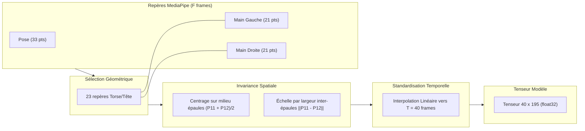

# LSFB Live — Reconnaissance en Direct de la Langue des Signes (LSFB)

<div align="center">

[](https://www.python.org/)
[-EE4C2C?style=for-the-badge&logo=pytorch&logoColor=white)](https://pytorch.org/)
[](https://developers.google.com/mediapipe)
[-darkblue?style=for-the-badge)](#4-résultats-expérimentaux--évaluation-sur-signeurs-inconnus)
[-purple?style=for-the-badge)](#4-résultats-expérimentaux--évaluation-sur-signeurs-inconnus)
[-69.28%25-success?style=for-the-badge)](#4-résultats-expérimentaux--évaluation-sur-signeurs-inconnus)
[](#5-architecture-du-projet)

*Un pipeline complet de Data Science : du corpus de poses de l'Université de Namur jusqu'à la classification temps réel face webcam sur un processeur standard d'ordinateur portable, sans carte graphique dédiée.*

</div>

---

## 1. Contexte & Présentation du Dataset LSFB

Dans le cadre de mes études en **Data Science**, j'ai voulu construire un projet centré sur la réalité de la modélisation statistique et séquentielle : gestion de distributions asymétriques, normalisation spatio-temporelle invariante et inférence temps réel sous contraintes de calcul.

### Le Corpus LSFB (Université de Namur)
La **LSFB** (Langue des Signes de Belgique Francophone) est la langue visuelle employée par la communauté sourde en Wallonie et à Bruxelles.

Le dataset utilisé est issu des travaux de recherche de l'**Université de Namur (UNamur)** :
- **Source :** Le *Corpus LSFB*, recensant des dizaines d'heures d'échanges spontanés entre une centaine de signeurs natifs, annotés par des linguistes.
- **Sous-ensemble LSFB-ISOL :** Une collection de clips segmentés signe par signe (120 739 instances réparties sur 4 657 classes lexicales).
- **Format Poses (Landmarks) :** Plutôt que de manipuler des flux vidéo lourds, le projet s'appuie directement sur les squelettes 3D nettoyés (coordonnées des articulations du corps et des mains extraites via MediaPipe). Ce choix assure une **cohérence parfaite** : le modèle est entraîné sur le format géométrique exact que la webcam produit en direct.

---

## 2. L'Exploration et les Caractéristiques des Données

L'analyse exploratoire complète menée sur le corpus est consignée dans [`docs/exploration_report.md`](docs/exploration_report.md).

```
   120 739 instances (LSFB ISOL global, 4 657 classes)
               │
               ├──► Top-100 signes (55 286 instances validées, v1.0 & v1.1)
               │      ├── Train : 21 401 instances (39 signeurs)
               │      ├── Val   :  9 136 instances (20 signeurs)
               │      └── Test  : 24 749 instances (40 signeurs non vus)
               │
               └──► Top-250 signes (75 825 instances validées, v1.2)
                      ├── Train : 29 324 instances (39 signeurs)
                      ├── Val   : 12 748 instances (20 signeurs)
                      └── Test  : 33 753 instances (40 signeurs non vus)
```

### Le déséquilibre de classes (15.2:1)
Même restreint au top 100, la distribution présente une forte asymétrie :
- Le signe le plus fréquent (`AUSSI`) compte **3 308 exemples**.
- Le 100ème signe (`HABITUDE`) n'en compte que **217**.
- Médiane par classe : 388 exemples.

> **Impact méthodologique :** Une exactitude brute (*Accuracy Top-1*) serait trompeuse face à un tel déséquilibre. L'évaluation repose donc sur la **Balanced Accuracy** (moyenne des rappels par classe), et l'entraînement intègre une fonction de perte **Class-Weighted CrossEntropy** proportionnelle à l'inverse des fréquences de chaque signe.

### Analyse temporelle et fenêtrage
L'étude de la longueur des séquences a mis en évidence :
- **Longueur minimale :** 4 frames.
- **Longueur médiane :** **16 frames** (~0,53 seconde à 30 fps).
- **Moyenne :** 19,7 frames.
- **95ème percentile :** **41 frames** (~1,36 seconde).

> **Choix de modélisation :** Une séquence standardisée à **$T = 40$ frames** par rééchantillonnage linéaire permet de capter l'intégralité de la dynamique de plus de 95% des signes, tout en maintenant une empreinte mémoire compacte.

---

## 3. Pipeline de Normalisation Invariante

Pour qu'un modèle entraîné sur des enregistrements de studio fonctionne face à une webcam personnelle (cadrage rapproché, utilisateur décentré), les données subissent une normalisation géométrique stricte.

Ce pipeline est centralisé et partagé sans duplication dans [`src/lsfb_live/landmarks/`](src/lsfb_live/landmarks/) :



1. **Sélection de 65 repères anatomiques :**
   - 23 repères supérieurs MediaPipe Pose (nez, yeux, bouche, épaules, coudes, poignets). Les repères des membres inférieurs (23 à 32) sont écartés car hors champ et générateurs de bruit.
   - 21 repères pour chaque main.
   - Total : $65 \times 3 = 195$ caractéristiques par trame.
2. **Invariance de translation :** Centrage systématique de chaque trame sur le milieu des épaules.
3. **Invariance de distance / échelle :** Normalisation par la distance euclidienne inter-épaules $\|P_{11} - P_{12}\|_2$. Que l'utilisateur soit près ou loin de l'écran, l'échelle du squelette demeure identique.
4. **Occultations :** Les mains non détectées (`NaN`) sont substituées par 0.0 de façon déterministe.

---

## 4. Résultats Expérimentaux : Évaluation sur Signeurs Inconnus

Afin de mesurer la capacité réelle de généralisation, le protocole respecte une séparation stricte : **les 40 signeurs du split de test n'ont jamais été vus pendant l'entraînement.**

Trois étapes d'optimisation séquentielle sur CPU ont été comparées :

### Évolution des Modèles sur le Top-100 (v1.0 & v1.1)

| Version | Modèle | Caractéristiques | Top-1 Accuracy | Top-5 Accuracy | Balanced Accuracy | Test Loss |
|---|---|---|---|---|---|---|
| **v1.0** | Baseline BiGRU | 195 (Positions) | 44,80% | 75,76% | 44,66% | 2,1811 |
| **v1.0** | ConvTransformer | 195 (Positions) | 51,78% | 82,08% | 50,72% | 1,9043 |
| **v1.1** | **MSST-Transformer** | **390 (Pos + Vitesses $\Delta P$)** | **54,46%** | **83,23%** | **54,23%** | **1,7647** |

*(Le niveau du hasard sur 100 classes est de 1,0%).*

### Montée en Charge sur le Top-250 (v1.2 & v1.3 BiStream)

Le passage de 100 à 250 classes multiplie la combinatoire par 2,5 et densifie fortement l'espace des homonymes gestuels. Évalué sur **33 753 séquences de test** issues de 40 signeurs non vus :

| Échelle | Modèle | Classes | Features | Test Top-1 | Test Top-5 | Balanced Accuracy | Test Loss |
|---|---|---|---|---|---|---|---|
| *Hasard* | *Aléatoire uniforme* | *250* | *-* | *0,40%* | *2,00%* | *0,40%* | *5,5215* |
| **v1.1** | MSST-Transformer | 100 | 390 (Pos + Vel) | 54,46% | 83,23% | 54,23% | 1,7647 |
| **v1.2** | MSST-Transformer | 250 | 390 (Pos + Vel) | 39,68% | 70,67% | 41,64% | 2,5521 |
| **v1.3** | **BiStream-MSST (Phonologique)** | **250** | **416 (Corps + Mains + Phono)** | **37,75%** | **69,28%** | **39,11%** | **2,6497** |

> **Constat majeur :** Le modèle maintient **près de 70% en Top-5** sur 250 classes sur 40 signeurs non vus. Les signes bimanuels et articulés au torse atteignent plus de 85% à 91% de rappel individuel.

### Apports méthodologiques clés (v1.3 BiStream-MSST) :
1. **Architecture Bi-Stream à 416 entrées :** Découplage strict entre la macro-dynamique corporelle (138 features : haut du corps positions + vitesses) et les micro-configurations manuelles (252 features : 42 repères mains positions + vitesses traitées par convolutions multi-échelles $k=3, 5, 7$).
2. **Descripteurs géométriques phonologiques (26 scalaires) :** Encodage explicite des paramètres de la linguistique des signes (distances et vecteurs 3D inter-mains, points de contact des index, ancrages corporels nez/torse/épaules, extension des 10 doigts et vitesses/accélérations relatives).
3. **Focal Cross-Entropy ($\gamma = 1.5$) :** Réduction de 97% du gradient sur les signes faciles pour concentrer la capacité du modèle sur les distinctions fines entre homonymes gestuels.
4. **Temporal Cutout :** Masquage aléatoire de segments temporels pour forcer le Transformer à contextualiser les trajectoires.

### Analyse qualitative par signe (BiStream Top-250, v1.3)

```
Signes les mieux reconnus (> 82%) :
  1. ADORER         [======================================  ] 91.3%  (69 exemples)
  2. CONVENIR       [===================================     ] 87.5%  (56 exemples)
  3. INTERPRETE     [====================================    ] 85.4%  (123 exemples)
  4. RENCONTRER     [====================================    ] 84.6%  (117 exemples)
  5. CORPS          [===================================     ] 82.9%  (41 exemples)

Signes les plus délicats (< 5%) :
  1. FSIGN (Dactylologie) [                                  ]  0.0%  (108 exemples)
  2. ALLER                [=                                 ]  1.1%  (182 exemples)
  3. QUI                  [==                                ]  3.9%  (51 exemples)
  4. VOULOIR              [==                                ]  4.7%  (64 exemples)
  5. FACILE.10            [==                                ]  4.9%  (61 exemples)
```

---

## 5. Architecture du Projet

Le projet applique les principes d'architecture logicielle par domaine de la charte **ElmasCore** (séparation stricte, fonctions pures, 350 lignes max par fichier) :

```
src/lsfb_live/
├── dataset/         Téléchargement résilient, indexation et compilation des tenseurs
├── landmarks/       Normalisation invariante, vitesses et descripteurs phonologiques (416 dims)
├── recognition/     Modèles (BiGRU, ConvTransformer, MSST, BiStream), entraînement Focal, moteur live
├── capture/         Gestion du flux webcam et extracteur MediaPipe Tasks Holistic
└── display/         Rendu OpenCV du squelette, avatar paramétrique cinématique et écran scindé
```

La suite de 26 tests unitaires valide l'intégrité de l'ensemble de la chaîne :
```powershell
pytest -v
# ================= 26 passed in 10.36s =================
```

---

## 6. Guide de Démarrage Rapide

Les poids du modèle retenu v1.3 (`models/bistream_best.pt`, 3,42 Mo) entraîné sur le **Top-250** avec descripteurs phonologiques ainsi que le dictionnaire des 250 classes (`models/class_mapping.json`) sont directement configurés par défaut dans l'application (les poids v1.2 restent disponibles dans `models/msst_best.pt`).

### 1. Installation
```powershell
git clone https://github.com/elm-as/lsfb-live.git
cd lsfb-live

# Environnement Python 3.12 (requis pour MediaPipe Tasks)
python -m venv .venv
.\.venv\Scripts\Activate.ps1
pip install -e .
```

### 2. Tester en direct (Webcam)

#### Option A — Mode Coach Interactif (Idéal si vous ne connaissez pas les signes)
Si vous ne connaissez pas encore la langue des signes, ce mode ouvre un écran scindé : à gauche, un **avatar vectoriel paramétrique (base v3)** reproduit le geste canonique en miroir parfait avec des équations cinématiques fluides ; à droite, votre webcam analyse vos mouvements en temps réel avec compensation de framerate (fenêtre temporelle glissante de 1,3 s) et alerte bimanuelle intégrée !
```powershell
python scripts/practice.py
```
- **Touches :**
  - **`N`** : Signe suivant dans le catalogue guidé (`RENCONTRER`, `DIFFERENT`, `MAISON`, `CORPS`, `INTERPRETE`, `AVANCER`, `MONTRER`).
  - **`P`** : Signe précédent.
  - **`Q`** ou **`Échap`** : Quitter.

#### Option B — Mode Libre
```powershell
python scripts/live.py
```
*Le modèle MediaPipe Holistic (`holistic_landmarker.task`, 13 Mo) est téléchargé automatiquement dès le premier lancement si absent.*

- **Contrôles :**
  - Placez-vous face caméra (buste et mains visibles).
  - Le squelette articulé s'affiche en surimpression temps réel.
  - Le signe détecté et le niveau de confiance s'affichent en haut à gauche.
  - Le top-3 des candidats alternatifs est affiché en bas à gauche.
  - Appuyez sur **`Q`** ou **`Échap`** pour quitter.

### 3. Entraîner et évaluer un modèle (Optionnel)
```powershell
# Entraîner le MSST-Transformer (v1.1)
python scripts/train.py --model msst --epochs 12

# Évaluer sur les 40 signeurs du split de test
python scripts/evaluate.py --model-path models/msst_best.pt --model-type msst --use-velocity
```

---

## 7. Roadmap & Perspectives

- **v1.0 (Validé) :** Pipeline de base Top-100 (195 features, ConvTransformer à 51,8% Top-1 / 82,1% Top-5).
- **v1.1 (Validé) :** Enrichissement cinématique (390 features positions + vitesses, symétrie miroir, MSST-Transformer à **54,5% Top-1 / 83,2% Top-5 / 54,2% Balanced**).
- **v1.2 (Validé) :** Montée en charge sur le **Top-250** des signes LSFB (75 825 instances réelles, 33 753 séquences de test sur 40 signeurs non vus, **70,7% Top-5** et **41,6% Balanced Acc**).
- **v1.3 / Pré-v3 (Validé) :** Moteur d'inférence temps réel invariant au framerate (fenêtrage temporel de 1,3 s), filtre anti-parasite d'inactivité et **Avatar Paramétrique Vectoriel** mathématique (première brique du Text-to-Sign).
- **v2.0 (Prochaine étape) :** Reconnaissance continue sur flux non segmenté (LSFB-CONT) couplée à un modèle de langue (LLM) pour la traduction en phrases complètes.
- **v3.0 (Génération inverse) :** Text-to-Sign complet : synthèse de coordonnées 3D de squelettes pour animer l'avatar gestuel sur n'importe quel texte.

---

## Références

- **Corpus LSFB (Université de Namur) :** J. Fink, T. Hoyoux, R. Vander Donckt. *The LSFB Dataset: A Corpus for French Belgian Sign Language Recognition*.
- **Google Research :** Framework *MediaPipe* et bibliothèque *Tasks Vision*.

*Projet universitaire en Data Science — 2026.*
